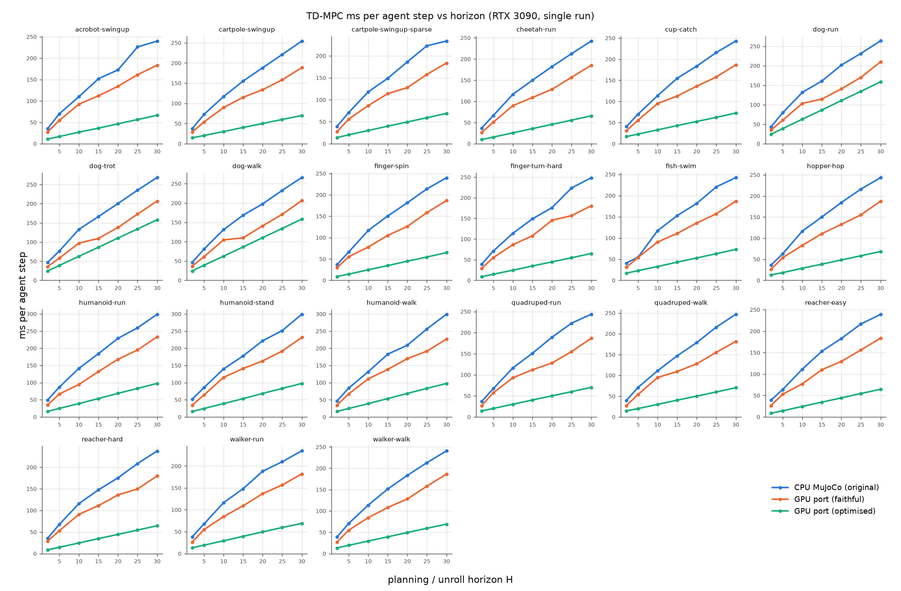
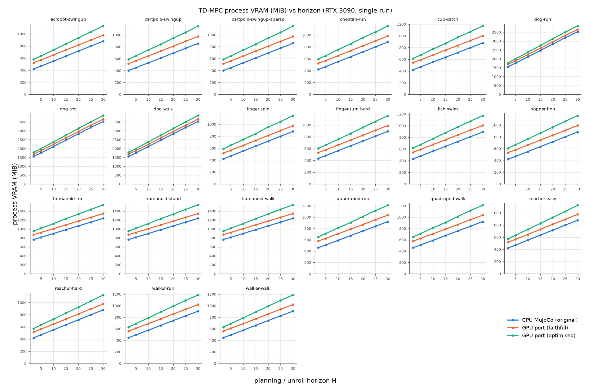
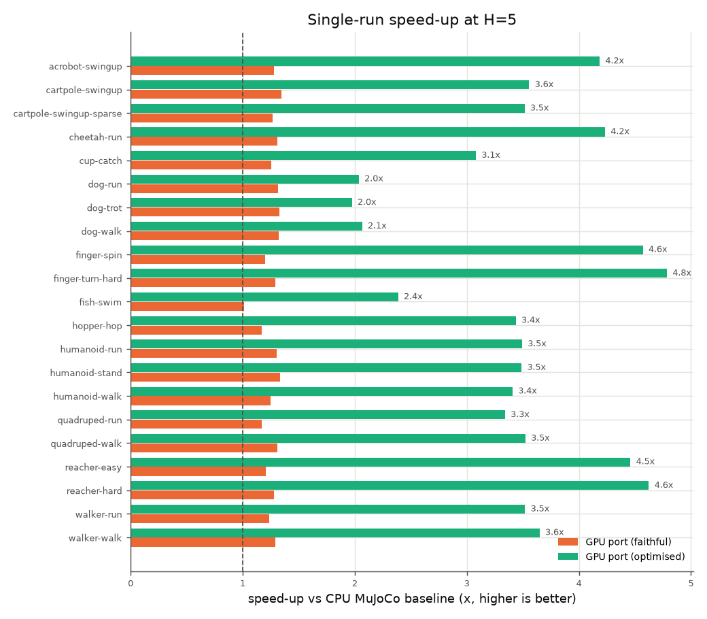

# 2. Single-run speed and peak VRAM vs horizon (H = 2 ... 30), CPU MuJoCo baseline vs GPU port

*tdmpc_gpu_warp: GPU port of TD-MPC by Keyshav Mor. Based on TD-MPC by Nicklas Hansen, Xiaolong Wang and Hao Su (https://github.com/nicklashansen/tdmpc).*

**Setup.** One run alone on the RTX 3090 (24 GiB, ~0.96 GiB used by the desktop). For every task and
H in {2, 5, 10, 15, 20, 25, 30} the steady-state cost of one agent step was measured with
`bench/bench_step.py`: replay buffer allocated at full capacity (as in training) and filled, schedules
completed (planning horizon = H, min std reached), then 60 agent steps of `plan + env.step`
followed by 60 `update`s (the training loop's collect-then-update pattern; one update per env step).
VRAM is the whole process as reported by `nvidia-smi` (CUDA context + kernels + buffers + allocator
cache) - the number that decides how many runs fit. Raw data: `results/sweep_h/<mode>/<task>_H<H>.json`
(441 configurations, 0 failures), full per-H tables: [`results_sweep_h.md`](results_sweep_h.md).

| mode | what runs |
|---|---|
| **CPU** (baseline) | original `tdmpc/src` unmodified: dm_control + MuJoCo 2.1 on CPU, agent on GPU (torch 2.4.1), default threading |
| **GPU faithful** | mujoco_warp env + the original eager agent (torch 2.11) |
| **GPU optimised** | mujoco_warp env + CUDA-graph agent (`graph_agent=true`) + host pacing (`pace_host=true`), same maths |

**Full-run time** is extrapolated from the measured per-step costs with the original loop structure
(`T = seed_steps*env + (train_steps-seed_steps)*(plan+env) + train_steps*update + evals`, 10 eval
episodes every 20k env steps; the 25k-step horizon warm-up is ignored, i.e. slightly pessimistic).

## Summary at the default horizon H = 5 and at H = 30

| task | env steps | H | CPU ms/step | GPU faithful ms | GPU optimised ms | speed-up faithful | speed-up optimised | full run CPU (h) | full run GPU faithful (h) | full run GPU optimised (h) | VRAM CPU / faithful / optimised (MiB) |
|---|---|---|---|---|---|---|---|---|---|---|---|
| acrobot-swingup | 500k | 5 | 70.0 | 54.7 | 16.7 | 1.28x | **4.19x** | 2.8 | 2.2 | 0.7 | 468 / 570 / 636 |
| acrobot-swingup | 500k | 30 | 239.6 | 183.3 | 66.3 | 1.31x | **3.61x** | 9.6 | 7.4 | 2.7 | 880 / 980 / 1132 |
| cartpole-swingup | 500k | 5 | 72.7 | 54.0 | 20.4 | 1.35x | **3.56x** | 1.4 | 1.1 | 0.5 | 448 / 564 / 648 |
| cartpole-swingup | 500k | 30 | 254.2 | 188.3 | 69.8 | 1.35x | **3.64x** | 5.0 | 3.8 | 1.4 | 858 / 974 / 1150 |
| cartpole-swingup-sparse | 500k | 5 | 71.0 | 55.9 | 20.2 | 1.27x | **3.51x** | 1.4 | 1.1 | 0.5 | 448 / 562 / 646 |
| cartpole-swingup-sparse | 500k | 30 | 233.5 | 183.4 | 69.0 | 1.27x | **3.39x** | 4.6 | 3.7 | 1.4 | 858 / 972 / 1148 |
| cheetah-run | 500k | 5 | 66.8 | 51.0 | 15.8 | 1.31x | **4.23x** | 2.7 | 2.0 | 0.7 | 468 / 570 / 652 |
| cheetah-run | 500k | 30 | 242.0 | 184.9 | 65.8 | 1.31x | **3.68x** | 9.6 | 7.5 | 2.7 | 882 / 984 / 1154 |
| cup-catch | 500k | 5 | 69.9 | 55.6 | 22.7 | 1.26x | **3.08x** | 2.8 | 2.2 | 1.0 | 470 / 590 / 672 |
| cup-catch | 500k | 30 | 242.9 | 186.5 | 72.7 | 1.30x | **3.34x** | 9.7 | 7.6 | 3.1 | 880 / 1002 / 1170 |
| dog-run | 5000k | 5 | 79.4 | 60.4 | 39.0 | 1.31x | **2.04x** | 64.8 | 49.1 | 33.4 | 1754 / 1884 / 1996 |
| dog-run | 5000k | 30 | 263.6 | 209.6 | 158.5 | 1.26x | **1.66x** | 217.2 | 173.5 | 125.5 | 3528 / 3654 / 3860 |
| dog-trot | 5000k | 5 | 76.6 | 57.8 | 38.8 | 1.33x | **1.97x** | 63.1 | 47.0 | 33.2 | 1754 / 1884 / 1996 |
| dog-trot | 5000k | 30 | 268.3 | 206.7 | 157.9 | 1.30x | **1.70x** | 220.5 | 170.9 | 125.0 | 3528 / 3654 / 3860 |
| dog-walk | 5000k | 5 | 80.8 | 61.2 | 39.1 | 1.32x | **2.07x** | 66.0 | 49.7 | 33.5 | 1754 / 1884 / 1996 |
| dog-walk | 5000k | 30 | 265.9 | 206.2 | 158.4 | 1.29x | **1.68x** | 218.5 | 170.6 | 125.4 | 3528 / 3654 / 3860 |
| finger-spin | 500k | 5 | 66.4 | 55.2 | 14.5 | 1.20x | **4.57x** | 5.3 | 4.4 | 1.2 | 470 / 564 / 648 |
| finger-spin | 500k | 30 | 239.8 | 186.5 | 64.8 | 1.29x | **3.70x** | 19.2 | 15.1 | 5.3 | 880 / 976 / 1144 |
| finger-turn-hard | 500k | 5 | 71.1 | 55.1 | 14.9 | 1.29x | **4.79x** | 5.7 | 4.4 | 1.3 | 482 / 578 / 660 |
| finger-turn-hard | 500k | 30 | 248.3 | 180.3 | 64.9 | 1.38x | **3.82x** | 19.9 | 14.6 | 5.4 | 892 / 990 / 1158 |
| fish-swim | 500k | 5 | 54.5 | 53.9 | 22.8 | 1.01x | **2.39x** | 2.2 | 2.2 | 1.1 | 480 / 594 / 676 |
| fish-swim | 500k | 30 | 242.3 | 186.6 | 72.9 | 1.30x | **3.32x** | 9.7 | 7.6 | 3.1 | 894 / 1006 / 1174 |
| hopper-hop | 500k | 5 | 63.0 | 53.9 | 18.3 | 1.17x | **3.44x** | 2.5 | 2.1 | 0.8 | 468 / 580 / 666 |
| hopper-hop | 500k | 30 | 243.2 | 187.5 | 68.4 | 1.30x | **3.56x** | 9.7 | 7.6 | 2.8 | 882 / 994 / 1160 |
| humanoid-run | 3000k | 5 | 86.9 | 66.7 | 24.9 | 1.30x | **3.49x** | 43.7 | 33.7 | 13.7 | 814 / 922 / 1014 |
| humanoid-run | 3000k | 30 | 298.7 | 233.0 | 97.6 | 1.28x | **3.06x** | 152.4 | 120.0 | 51.8 | 1238 / 1346 / 1538 |
| humanoid-stand | 3000k | 5 | 85.7 | 64.2 | 24.6 | 1.34x | **3.49x** | 43.1 | 32.6 | 13.6 | 814 / 922 / 1014 |
| humanoid-stand | 3000k | 30 | 298.9 | 231.6 | 97.6 | 1.29x | **3.06x** | 152.2 | 119.1 | 51.8 | 1238 / 1346 / 1538 |
| humanoid-walk | 3000k | 5 | 84.0 | 67.2 | 24.6 | 1.25x | **3.41x** | 42.4 | 34.0 | 13.6 | 814 / 922 / 1014 |
| humanoid-walk | 3000k | 30 | 298.9 | 226.5 | 97.5 | 1.32x | **3.06x** | 152.0 | 116.8 | 51.8 | 1238 / 1346 / 1538 |
| quadruped-run | 500k | 5 | 67.5 | 57.5 | 20.2 | 1.17x | **3.34x** | 2.7 | 2.3 | 0.9 | 508 / 624 / 710 |
| quadruped-run | 500k | 30 | 243.5 | 186.5 | 70.2 | 1.31x | **3.47x** | 9.7 | 7.5 | 2.9 | 922 / 1036 / 1210 |
| quadruped-walk | 500k | 5 | 70.9 | 54.1 | 20.1 | 1.31x | **3.52x** | 2.8 | 2.2 | 0.9 | 508 / 624 / 710 |
| quadruped-walk | 500k | 30 | 246.7 | 181.5 | 70.2 | 1.36x | **3.51x** | 9.9 | 7.3 | 2.9 | 922 / 1036 / 1210 |
| reacher-easy | 500k | 5 | 64.0 | 53.1 | 14.4 | 1.21x | **4.46x** | 2.6 | 2.1 | 0.6 | 470 / 564 / 632 |
| reacher-easy | 500k | 30 | 238.9 | 183.4 | 64.4 | 1.30x | **3.71x** | 9.6 | 7.4 | 2.6 | 880 / 976 / 1124 |
| reacher-hard | 500k | 5 | 67.6 | 52.9 | 14.6 | 1.28x | **4.62x** | 2.7 | 2.1 | 0.6 | 470 / 564 / 632 |
| reacher-hard | 500k | 30 | 237.7 | 179.6 | 64.5 | 1.32x | **3.69x** | 9.5 | 7.3 | 2.6 | 880 / 976 / 1124 |
| walker-run | 500k | 5 | 67.8 | 54.8 | 19.3 | 1.24x | **3.52x** | 5.4 | 4.4 | 1.7 | 494 / 608 / 690 |
| walker-run | 500k | 30 | 234.6 | 182.1 | 68.9 | 1.29x | **3.40x** | 18.9 | 14.8 | 5.8 | 906 / 1020 / 1186 |
| walker-walk | 500k | 5 | 70.6 | 54.7 | 19.3 | 1.29x | **3.65x** | 5.6 | 4.4 | 1.7 | 494 / 608 / 690 |
| walker-walk | 500k | 30 | 240.6 | 186.2 | 68.9 | 1.29x | **3.49x** | 19.4 | 15.1 | 5.8 | 906 / 1020 / 1186 |
## Observations

* **GPU optimised is 2.4-4.8x (mean 3.7x; fish-swim lowest) faster than the CPU baseline for every non-dog task at H = 5 and
  3.1-3.8x (mean 3.5x) at H = 30**; dog (batch 2048, latent 100) gains 2.0x at H = 5 and 1.7x at H = 30.
  Extrapolated full runs at H = 5: walker-walk (500k env steps) 5.6 h -> 1.7 h, humanoid-run (3M) 43.7 h ->
  13.7 h, dog-run (5M) 64.8 h -> 33.4 h.
* The **faithful port is only 1.2-1.4x faster**: replacing CPU physics by GPU physics removes the
  host<->device traffic but the original agent is *CPU-launch bound* - a 512-batch TOLD update takes
  ~40-48 ms of wall time but only ~7 ms of GPU time, and the GPU sits idle 64-86 % of the time
  (GPU utilisation 14 % for the CPU baseline, 36 % faithful, 89 % optimised on walker-walk H = 5).
  CUDA graphs remove this launch overhead; that is where most of the speed-up comes from.
* The single-world GPU physics step is *latency* bound (~100 tiny kernels per physics sub-step,
  e.g. 5.6 ms per walker agent step = 20 sub-steps), so for one run the GPU env alone is slower than
  CPU MuJoCo (0.3-1.5 ms). It does not matter for one run (plan + update dominate) and it disappears
  when many seeds share one env (`nworld = S`, chapter 4).
* **Time grows linearly with H** for all modes (plan rolls the model H steps 6 CEM iterations x 537
  trajectories; update unrolls H steps), so speed-ups are nearly H-independent.
* **VRAM grows linearly with H**: +16.4-16.9 MiB per unit of H for all batch-512 tasks and
  +71 MiB per H for dog (batch 2048, latent 100) - activations of the H-step unroll kept for backward.
  The GPU port costs +100-120 MiB (faithful: warp module images, mujoco_warp buffers) and +170-240 MiB
  (optimised: + CUDA-graph memory pools, +3.5 MiB per H) per process over the CPU baseline. The fixed
  part (~0.45-0.5 GiB, dog ~1.4 GiB incl. its 0.9 GiB replay buffer) is dominated by the CUDA context.
