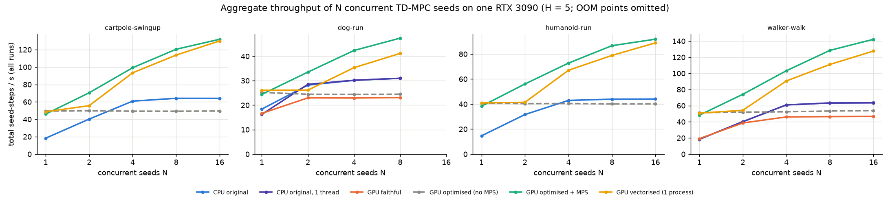
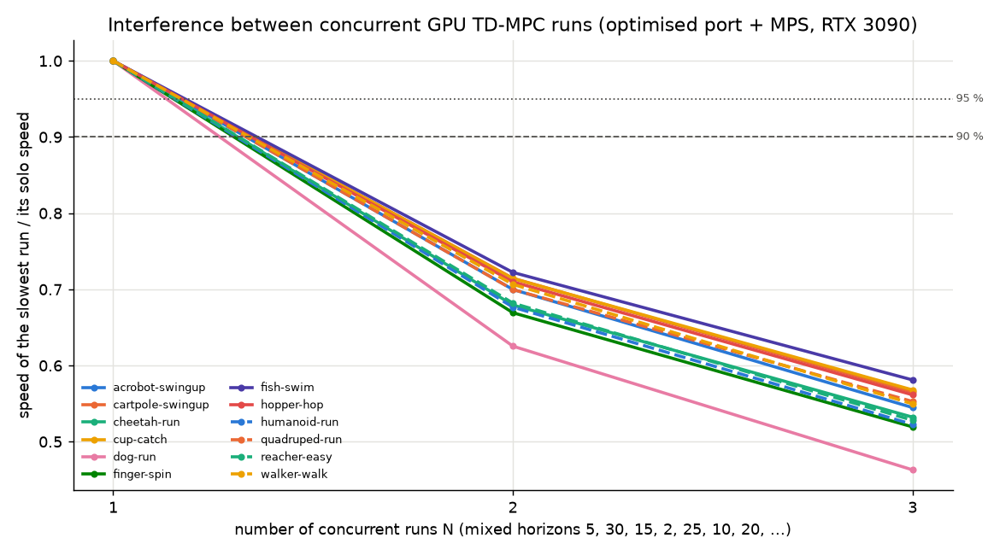

# 4. How many runs fit on one RTX 3090 - and how many without slowing each other down

*tdmpc_gpu_warp: GPU port of TD-MPC by Keyshav Mor. Based on TD-MPC by Nicklas Hansen, Xiaolong Wang and Hao Su (https://github.com/nicklashansen/tdmpc).*

This chapter answers the question that matters for planning experiments: *given a task, how many TD-MPC
runs (seeds and/or different horizons) can share the RTX 3090, (a) in memory and (b) without any run
becoming slower than it would be alone?* Two very different limits exist:

| limit | what decides it | typical value (this machine) |
|---|---|---|
| **memory limit** | sum of per-run VRAM <= 23.6 GiB free | 8-35 separate runs, up to 200+ seeds in one vectorised process |
| **no-slowdown (interference-free) limit** | GPU compute / scheduling | see section A - much smaller |

## 4.1 Why concurrent GPU runs interfere

* **Without MPS the driver time-slices processes**: kernels of different processes never run at the same
  time. N optimised runs then share the GPU exactly like one run: total throughput stays constant and
  every run is N times slower (contention study: cartpole 49.4 -> 49.7 -> 49.3 total seed-steps/s for
  N = 1, 2, 4). More processes do *not* help.
* **With CUDA MPS** kernels of different processes run concurrently on the SMs. Because one TD-MPC run is a
  stream of small, partly latency-bound kernels (physics ~100 kernels per sub-step for one world, 512-trajectory
  planning MLPs, batch-512 updates), several runs can overlap - total throughput grows (cartpole: 46 -> 70 -> 99
  -> 120 -> 132 seed-steps/s for N = 1, 2, 4, 8, 16) - but each additional run takes SM time away from the
  others, so *per-run* speed drops as soon as the GPU is saturated.
* **The optimised port saturates the GPU with very few runs**, precisely because it removed the CPU
  bottleneck: a single optimised run keeps the GPU busy ~86-89 % of the time (the original CPU-MuJoCo run:
  14-27 %, it mostly waits for the CPU). Consequently the *original* code can run ~2 seeds side by side
  without slowing either down - but each of them is 2.5x slower than one optimised GPU run.
* **CPU contention is gone in the GPU port**: one run needs 0.02-0.17 CPU cores (host pacing + CUDA graphs)
  instead of a full core, so 16 cores are never the limit (the original saturates the 16 cores at N = 16:
  system CPU 99 %).

## 4.2 Three ways to share the GPU

| mode | how | when to use |
|---|---|---|
| separate processes + **MPS** | `nvidia-cuda-mps-control -d`, then launch runs | runs with *different* configurations (horizons, tasks) |
| separate processes + **MPS SM partitioning** | additionally `CUDA_MPS_ACTIVE_THREAD_PERCENTAGE=p` | when runs must not influence each other's speed (isolation, predictable timing) - section C |
| **one vectorised process** (`train_vec.py num_seeds=S`) | seeds of one configuration in lockstep | many seeds of the same configuration - best memory and throughput efficiency |

## 4.3 Reading the numbers below

* *relative speed* of a run = its agent steps/s while sharing the GPU / its steps/s alone at the same horizon;
* *no-slowdown capacity (<= 5 %)* = largest N for which every run keeps >= 95 % of its solo speed;
* *total steps/s* = sum over runs; per-run speed = total / N;
* for comparison: one run of the **original CPU-MuJoCo code alone** reaches ~14-18 agent steps/s at H = 5;
  an optimised GPU run alone 25-65 (dog slowest, reacher fastest).

## 4.4 Answer: runs per task and horizon - in memory vs without slowing each other down (Q1)

**Measured result: on the RTX 3090, for every task and every horizon from H = 2 to H = 100, only ONE
optimised GPU run can execute without being slowed down.** A second concurrent run - same horizon or a
different one - costs *each* run 20-42 % of its speed (H = 2: each keeps 71-80 %; H = 30: 58-69 %;
H = 50/100: 59-67 %); a third run brings every run to ~46-60 %. Memory is never the binding constraint:
8-41 runs of one horizon would fit (table below). The reason is structural: one optimised run keeps the GPU
busy 86-97 % of the time; there is no idle capacity left for a second run to use for free.

Per task: memory limit (number of separate processes of the same H that fit) and measured interference
(full raw tables, incl. mixed-horizon trials and total throughput: [results_capacity.md](results_capacity.md)):

| task | H=2 mem | H=5 mem | H=10 mem | H=15 mem | H=20 mem | H=25 mem | H=30 mem | 2 runs at H=2: each | 2 runs at H=30: each | no-slowdown limit (any H) |
|---|---|---|---|---|---|---|---|---|---|---|
| acrobot-swingup | 40 | 37 | 32 | 28 | 25 | 22 | 20 | 0.76 | 0.64 | **1** |
| cartpole-swingup | 40 | 36 | 31 | 28 | 24 | 22 | 20 | 0.77 | 0.66 | **1** |
| cheetah-run | 39 | 36 | 31 | 27 | 24 | 22 | 20 | 0.74 | 0.63 | **1** |
| cup-catch | 38 | 35 | 30 | 27 | 24 | 22 | 20 | 0.79 | 0.67 | **1** |
| dog-run | 13 | 11 | 9 | 8 | 7 | 6 | 6 | 0.71 | 0.58, H=50: 0.60, H=100: 0.59 | **1** |
| finger-spin | 40 | 36 | 31 | 28 | 24 | 22 | 20 | 0.74 | 0.64 | **1** |
| fish-swim | 38 | 34 | 30 | 26 | 24 | 21 | 20 | 0.79 | 0.69 | **1** |
| hopper-hop | 38 | 35 | 30 | 27 | 24 | 22 | 20 | 0.77 | 0.66 | **1** |
| humanoid-run | 24 | 23 | 21 | 19 | 17 | 16 | 15 | 0.74 | 0.63 | **1** |
| quadruped-run | 36 | 33 | 29 | 26 | 23 | 21 | 19 | 0.77 | 0.65 | **1** |
| reacher-easy | 41 | 37 | 32 | 28 | 25 | 23 | 21 | 0.74 | 0.63 | **1** |
| walker-walk | 37 | 34 | 29 | 26 | 23 | 21 | 19 | 0.78 | 0.69, H=50: 0.67, H=100: 0.66 | **1** |

Mixed horizons (5, 30, 15, 2, 25, 10, 20 cycled), all 12 domains, MPS: 2 runs -> slowest run 0.63-0.72 of solo
(mean 0.68-0.77); 3 runs -> 0.46-0.58. **No-slowdown capacity = 1 for all 12 domains.**
For comparison, the original CPU-MuJoCo code tolerates **2** runs without slowdown (it leaves the GPU idle
while waiting for the CPU) - but each of those runs is 2.5-3.5x slower than one optimised GPU run, and even
with 2 GPU runs sharing the GPU each GPU run is still ~1.7x faster than an undisturbed CPU run.

## 4.5 Answer: seeds x horizon settings (Q2)

k seeds at *each* of H = 2, 5, 10, 15, 20, 25, 30 (7k runs): largest k that fits in VRAM - as separate
processes, as one vectorised process per horizon, and with activation checkpointing (exact). The
no-slowdown limit of any such set is again **1 run in total** (4.4).

| task | (a) processes: k | total runs | (b) vectorised: k | total runs | (c) vectorised + ckpt: k | total runs |
|---|---|---|---|---|---|---|
| acrobot-swingup | 4 | 28 | 7 | 49 | 32 | 224 |
| cartpole-swingup | 3 | 21 | 7 | 49 | 35 | 245 |
| cartpole-swingup-sparse | 3 | 21 | 7 | 49 | 35 | 245 |
| cheetah-run | 3 | 21 | 6 | 42 | 30 | 210 |
| cup-catch | 3 | 21 | 6 | 42 | 33 | 231 |
| dog-run | 1 | 7 | 1 | 7 | 2 | 14 |
| dog-trot | 1 | 7 | 1 | 7 | 2 | 14 |
| dog-walk | 1 | 7 | 1 | 7 | 2 | 14 |
| finger-spin | 3 | 21 | 6 | 42 | 29 | 203 |
| finger-turn-hard | 3 | 21 | 6 | 42 | 29 | 203 |
| fish-swim | 3 | 21 | 6 | 42 | 28 | 196 |
| hopper-hop | 3 | 21 | 6 | 42 | 30 | 210 |
| humanoid-run | 2 | 14 | 3 | 21 | 6 | 42 |
| humanoid-stand | 2 | 14 | 3 | 21 | 6 | 42 |
| humanoid-walk | 2 | 14 | 3 | 21 | 6 | 42 |
| quadruped-run | 3 | 21 | 5 | 35 | 17 | 119 |
| quadruped-walk | 3 | 21 | 5 | 35 | 17 | 119 |
| reacher-easy | 4 | 28 | 7 | 49 | 33 | 231 |
| reacher-hard | 4 | 28 | 7 | 49 | 33 | 231 |
| walker-run | 3 | 21 | 6 | 42 | 24 | 168 |
| walker-walk | 3 | 21 | 6 | 42 | 24 | 168 |

## 4.6 Can SM partitioning make runs interference-free? No.

With `CUDA_MPS_ACTIVE_THREAD_PERCENTAGE` each run gets a fixed share of the SMs, but runs still share
memory bandwidth, L2 cache and the GPU front-end: 2 x 50 % -> each run reaches only 0.78-0.82 of its speed
*alone with the same 50 % share* (4 x 25 %: 0.66-0.70), and per-run speed (0.68-0.70 / 0.41-0.48 of an
unrestricted solo run) is no better than plain MPS sharing. Partitioning was therefore rejected.

## 4.7 Throughput when the GPU is shared anyway (same H = 5, N seeds)

Even though every run slows down, sharing increases the *total* number of environment steps per second -
which is what decides when a batch of seeds finishes (raw: [results_capacity.md](results_capacity.md) B):

| N seeds | CPU original | GPU, separate processes + MPS | GPU, one vectorised process | GPU, processes WITHOUT MPS |
|---|---|---|---|---|
| 1 | 1x | 1x | 1x | 1x |
| 4 | 3.0-3.3x | 1.9-2.2x | 1.6-1.9x | 1.0x |
| 8 | 3.0-3.5x | 2.3-2.7x | 1.9-2.3x | 1.0x |
| 16 | 3.0-3.5x | 2.4-3.0x | 2.2-2.7x | 1.0x |

(cartpole, walker, humanoid; relative to one run of the same mode alone. Absolute, walker-walk: CPU 18 ->
63 seed-steps/s at 8 runs; GPU + MPS 48 -> 128 at 8 and 142 at 16 runs; dog saturates earlier, ~1.9x.)
Without MPS, processes are time-sliced and total throughput never increases.

**Caveat - MPS fault containment:** under MPS a fatal GPU error in *one* client tears down *all* clients on
that GPU. This happened twice while ~10 learning runs shared the GPU. A latent
undefined-behaviour bug in the env's external CUDA-graph capture (warp destroying a graph owned by torch,
chapter 1, gotcha 7) was found and fixed, but rare faults in vectorised multi-world processes remain (chapter 8).
The containment property itself is inherent to MPS: one faulting run kills all co-running runs, so stagger starts
and prefer separate single-seed processes (`train.py graph_agent=true pace_host=true`) for long runs.

## 4.8 Recommendation: how to organise 5 seeds x n tasks

> **Scope: humanoid and dog tasks.** humanoid-run/-stand/-walk and dog-run/-trot/-walk are ported to the GPU,
> and their environments, speed and memory were measured in short benchmarks (those numbers appear in the tables).
> They were **not** trained, and they are excluded from the learning-curve tests and the remaining baseline work
> (MPS stability tests, re-timings, further optimisation). Their training budgets (3M / 5M environment steps, about
> 14-33 h per seed even on the optimised GPU port, 1.4-3.9 days per 5-seed batch in parallel) make them too expensive to pursue for
> this project. The optimised baseline is therefore established and verified on the other 15 tasks.

Question: run the seeds back-to-back (task 1 seed 1 -> ... -> task n seed 5, one run at a time) or always keep a few
seed runs in parallel? **Parallel finishes ~2x earlier.** A single run cannot use the whole GPU efficiently (latency-
bound small kernels), so co-running runs raise the *total* throughput even though each run slows down:

| N concurrent runs (MPS) | total throughput vs 1 run (non-dog) | dog | each run's speed |
|---|---|---|---|
| 1 | 1.0x | 1.0x | 100 % |
| 2 | 1.4-1.5x | 1.4x | ~70-77 % |
| 4 | 1.9-2.2x | 1.7x | ~50 % |
| 8 | 2.3-2.7x | 1.9x | ~30 % |
| 16 | 2.4-3.0x | OOM (> 11 dog runs) | ~18 % |

Projected wall time for **all 21 tasks x 5 seeds at H = 5 with their default training budgets** (single-run times
from the horizon sweep; dog's 5M-step budget is 500 of the 776 GPU-hours):

| strategy | total time |
|---|---|
| original CPU-MuJoCo code, back-to-back | ~77 days |
| original CPU-MuJoCo code, 4-8 runs in parallel | ~36 days |
| GPU port (optimised), back-to-back | ~32 days |
| **GPU port, 5 seeds of one task in parallel (MPS)** | **~17 days** |
| **GPU port, 8-16 runs in parallel (MPS)** | **~15 days** |

Advice:
1. **Run in parallel, ~5-8 runs at a time** (e.g. the 5 seeds of a task, or 5 seeds of a heavy task + a few seeds of a
   light task). Beyond ~8 runs the total gain flattens (2.7x -> 3.0x) while every run becomes much slower and memory
   gets tight for dog (<= 11 dog runs at H = 5, <= 6 at H = 30).
2. Start the **MPS daemon** first (otherwise processes are time-sliced and parallelism gives *nothing*: 1.0x).
3. Use **separate single-world processes** (`train.py graph_agent=true pace_host=true`). Under MPS they faulted once
   (versus 7 times for the vectorised `train_vec.py`), but a fault under MPS ends all co-running runs (chapter 8), and no
   resume is implemented. So check the runs regularly; if crashes recur, fall back to running without MPS (no fault
   observed, but no parallel speed-up). `train_vec.py` (one process, many seeds: same throughput, ~4x less VRAM per
   seed) is the more efficient design but has the highest fault rate; use it for shorter runs, without MPS.
4. Order heavy tasks (dog, humanoid: long budgets) first and fill the remaining slots with light tasks, so the GPU never
   runs a single straggler alone at the end.

## 4.9 Validation: real 5-seed batches under MPS

The recommended configuration (5 single-seed runs in parallel under MPS, `src/launch_parallel.py --mps`, checkpoints
every 15 min) was run end to end. Setup:
- 6 tasks (walker-walk, cheetah-run, finger-spin, cartpole-swingup, reacher-easy, cup-catch);
- the full 500k-step budget, one task after another;
- no other CUDA process on the GPU (`bench/mps_batches.py`, [results_mps_batches.md](results_mps_batches.md)).

| task | measured batch time | vs original CPU code, 5 seeds parallel | vs original, back-to-back |
|---|---|---|---|
| walker-walk | 3.90 h | 2.1x faster | 7.2x faster |
| cheetah-run | 1.65 h | 2.4x | 8.0x |
| finger-spin | 3.31 h | 2.4x | 8.0x |
| cartpole-swingup | 0.97 h | 2.2x | 7.4x |
| reacher-easy | 1.63 h | 2.3x | 7.8x |
| cup-catch | 2.17 h | 1.9x | 6.4x |
| **6 tasks** | **13.6 h** | **2.2x** | **7.5x** |

**Stability:**
- 68 process-hours of real training under MPS with 0 crashes, 0 restarts and 0 kernel GPU fault records.
- Together with the stress tests of docs/08 that makes 0 faults in about 110 process-hours of MPS-only operation.

**Learning:**
- Per-seed mean return over the whole run vs the paper's reference (Welch tests):
  - walker +0.4 % (p = 0.65), finger -0.8 % (0.53), cartpole +0.3 % (0.32), reacher -1.2 % (0.32), cup +0.3 % (0.74);
  - cheetah-run +6.0 % (p = 0.085): a trend above the paper, not significant; checked against the original code run
    on this machine (see results_mps_batches.md).
- Measured times were within -6 % to +10 % of the prediction, except for tasks with very cheap physics (finger-spin,
  reacher-easy: +20-25 %, measured parallel factor 1.8x instead of 2.3x; results_runtime.md).
