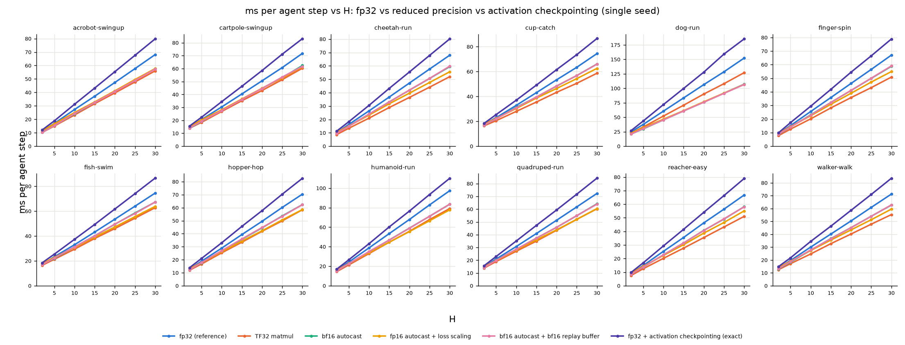
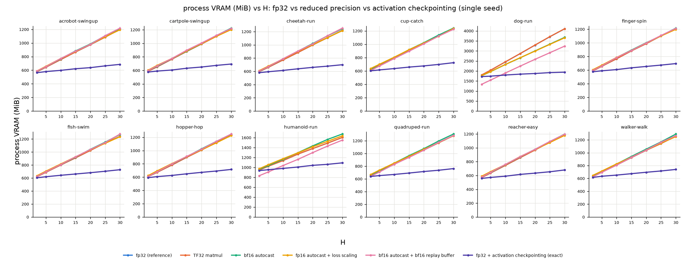

# 7. Reduced precision (bf16 / fp16 / TF32): accuracy, peak VRAM and speed

*tdmpc_gpu_warp: GPU port of TD-MPC by Keyshav Mor. Based on TD-MPC by Nicklas Hansen, Xiaolong Wang and Hao Su (https://github.com/nicklashansen/tdmpc).*

All variants run the same vectorised agent code; `precision=fp32` (default) is the original numerics.
* `tf32`: TF32 tensor-core matmuls (10-bit mantissa inputs, fp32 accumulate).
* `bf16` / `fp16`: `torch.autocast` around every forward pass of `plan()` and `update()`; master weights,
  optimiser states and losses in fp32; planning returns accumulated in fp32. fp16 additionally uses dynamic
  loss scaling with GradScaler's default schedule, implemented capturably per seed (masked Adam, verified
  equal to `torch.optim.Adam` to 2e-6).
* `buffer_dtype=bf16`: observations stored in bf16 in the replay buffer (halves its size).
None of these is mathematically equivalent to the baseline (they change rounding) - they are options.

## 7.1 Speed and VRAM, single seed (12 domains x H = 2..30, `results_precision.md`)

| variant | mean speed-up H=5 | mean speed-up H=30 | mean dVRAM H=5 (MiB) | mean dVRAM H=30 (MiB) |
|---|---|---|---|---|
| TF32 matmul | 1.14x | 1.24x | +0 | +0 |
| bf16 autocast | 1.09x | 1.16x | +3 | -16 |
| fp16 autocast + loss scaling | 1.06x | 1.22x | +12 | -40 |
| bf16 autocast + bf16 replay buffer | 1.08x | 1.17x | -47 | -68 |
| fp32 + activation checkpointing (exact) | 0.90x | 0.85x | -85 | -653 |

* For **one seed** the GPU is latency-bound (small batch, thousands of small kernels), so tensor cores help
  little: 1.06-1.24x on average; dog (batch 2048) gains up to 1.42x (bf16, H = 30).
* **VRAM barely changes** (-16 to -68 MiB on average at H = 30; dog -0.4 GiB, -0.9 GiB with the bf16 buffer).

## 7.2 Speed, many seeds in one process (compute-saturated regime, H = 5)

| config | fp32 | TF32 | bf16 | fp16 | VRAM fp32 -> bf16 |
|---|---|---|---|---|---|
| walker-walk, 16 seeds (seed-steps/s) | 127.8 | 159.2 (1.25x) | 206.1 (1.61x) | 193.7 (1.52x) | 3.09 -> 2.99 GiB |
| dog-run, 8 seeds (seed-steps/s) | 41.2 | 51.6 (1.25x) | 68.9 (1.67x) | 67.0 (1.63x) | 12.15 -> 11.39 GiB |

Once the GPU is saturated by many seeds, bf16/fp16 give **~1.5-1.7x** throughput and TF32 **1.25x**.

## 7.3 Why autocast saves so little memory (`bench/test_amp_memory.py`)

Bytes saved by autograd for the backward pass of one update at H = 30 (1 seed):

| task | fp32 | bf16 (bf16 part + fp32 part) | update peak above resident, fp32 -> bf16 |
|---|---|---|---|
| walker-walk | 1172 MiB | 741 MiB (430 + 311) | 554 -> 472 MiB |
| dog-run | 4140 MiB | 2703 MiB (1436 + 1267) | 2367 -> 1837 MiB |

Autocast keeps LayerNorm (every Q-network), the latent/action concatenation (fp32 action promotes the
result to fp32) and all loss inputs in fp32 and *adds* low-precision cast copies that are saved too, so only
~35 % of the saved bytes disappear, and activations are only a part of the process footprint (CUDA context,
buffers, workspaces, graph pools). The exact activation checkpointing (chapter 6) removes ~95 % of the same
activation memory without changing a single bit.

## 7.4 Learning accuracy (walker-walk, eval return; results_learning.md)

| env steps | paper reference (5) | fp32 GPU (5) | bf16 (3) | fp16 (3) |
|---|---|---|---|---|
| 0 | 35 +- 1 | 36 +- 2 | 36 +- 2 | 36 +- 2 |
| 20k | 447 +- 212 | 554 +- 222 | 489 +- 155 | 564 +- 96 |
| 40k | 954 +- 6 | 910 +- 67 | 944 +- 8 | 936 +- 28 |

bf16 and fp16 learn like fp32 on walker-walk (A/B vs fp32: p = 0.33-0.94; vs reference: p >= 0.14; these runs were made
before the PER replacement-flag fix of docs/06 section 6.4, with the same sampling in the fp32 comparison runs) within the
resolution of 3 seeds. The fp16 run uses dynamic loss scaling; an early fp16 run exposed a bug in the capturable
scaler (growth counter not persisted across graph replays), fixed before the reported run.

## 7.5 Recommendation

Reduced precision is **not** mathematically equivalent and is therefore not enabled by default. It is worth it
only in the compute-saturated regime (many seeds per GPU: ~1.6x throughput) and only after confirming learning
curves on the task at hand; for memory, use the exact activation checkpointing instead.
